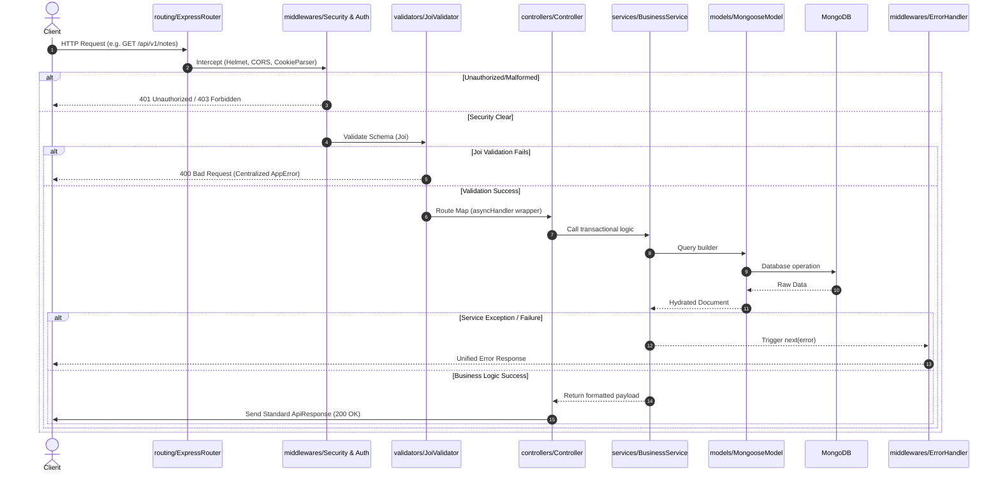
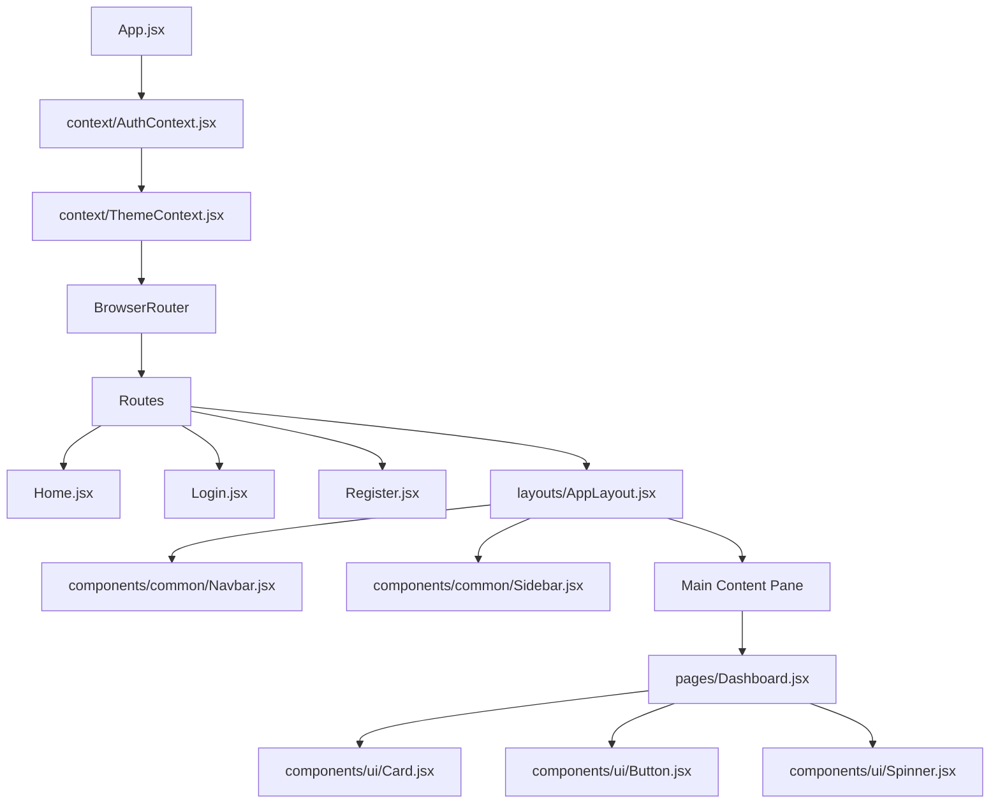
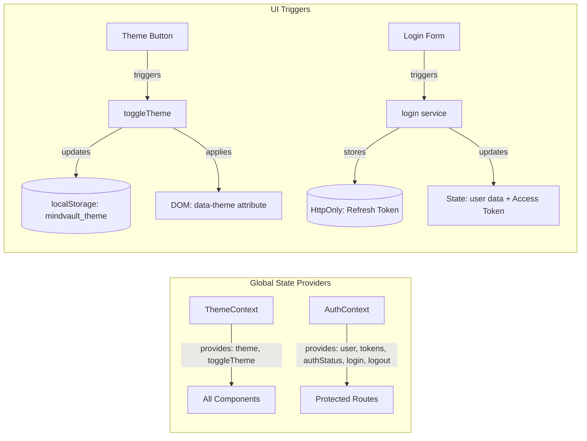
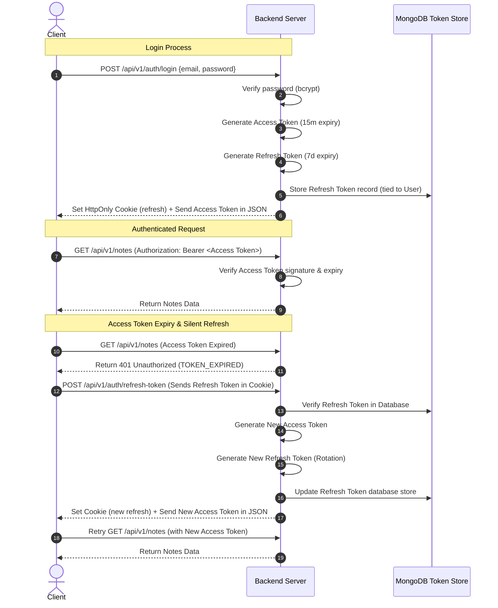

# Project Specification: MindVault (MERN PKM Application)

MindVault is a production-quality, high-performance Personal Knowledge Management (PKM) application designed to serve as a secure, offline-first-inspired digital workspace. This document specifies the complete system architecture, folder structures, visual frameworks, coding guidelines, schema topologies, and engineering standards for the project.

---

## 1. System Architecture & Diagrams

### 1.1. Backend Request-Response Lifecycle
Every incoming HTTP request undergoes schema validation, security inspection, auth decryption, controller mapping, service execution, and unified response wrapping.



### 1.2. Frontend Component Hierarchy (Milestone 1)


### 1.3. React State Management Flow (Auth & Theme Contexts)


### 1.4. Authentication Flow (JWT Rotation & Security)
MindVault utilizes a double-token architecture combining a short-lived memory-stored access token and a long-lived HttpOnly, secure, SameSite cookie-stored refresh token.



---

## 2. Directory Structure & Explanation

```
MindVault/
├── client/                     # Frontend Vite + React Source
│   ├── src/
│   │   ├── assets/             # Raw static resource files (e.g. SVG graphics, logos)
│   │   ├── components/
│   │   │   ├── common/         # Layout framing structures (Navbar, Sidebar, SidebarItem, EmptyState)
│   │   │   └── ui/             # Core reusable atomic controls (Button, Input, Card, Spinner, LoadingSkeleton)
│   │   ├── context/            # React Global State Providers (AuthContext, ThemeContext)
│   │   ├── hooks/              # Custom React Hooks (useAuth, useTheme, useLocalStorage)
│   │   ├── layouts/            # Layout shells (AppLayout - containing Navbar, Sidebar, and Content Outlet)
│   │   ├── pages/              # Routed screen view files (Home, Login, Register, Dashboard)
│   │   ├── routes/             # Client-side router mappings and Guards (Protected & Public Route filters)
│   │   ├── services/           # Axios networking layer (api.js instance with interceptors)
│   │   ├── constants/          # Client-side constants (routes, limits, messages, themes, storage keys)
│   │   ├── styles/             # Modular custom stylesheets and CSS custom variables
│   │   ├── utils/              # Client helpers (date formatters, text counters)
│   │   ├── App.jsx             # React entry wrapper mapping routes
│   │   └── main.jsx            # Application root mounter
│   ├── eslint.config.js        # Frontend styling rules
│   ├── index.html              # Core HTML structure
│   └── vite.config.js          # Vite compiler configs
│
├── server/                     # Backend Node.js + Express Source
│   ├── config/                 # Startup infrastructure configs (db.js, logger configs)
│   ├── constants/              # Centralized backend constants, HTTP statuses, and errorCodes.js
│   ├── controllers/            # Route orchestrators (extract payload, pass to services, call API wrappers)
│   ├── logs/                   # Target logs files output folder (combined.log, error.log)
│   ├── middlewares/            # Request interception pipeline (errorHandler.js, morganLogger.js, rateLimiter.js)
│   ├── models/                 # Mongoose schemas & indexes definitions
│   ├── routes/                 # Express API endpoint declaration mappings
│   ├── services/               # Pure transactional business services layer
│   ├── uploads/                # Local directory for disk-based attachments (PDF, documents)
│   ├── utils/                  # Backend utilities (appError.js, apiResponse.js, asyncHandler.js)
│   ├── validators/             # Joi request body & query schema definitions
│   ├── app.js                  # Express middleware wiring app
│   ├── eslint.config.js        # Backend styling rules
│   └── server.js               # Web server listener entry mounter
```

---

## 3. Database Design & Relationships

MindVault maps entity hierarchies as structured relationships using reference linkages (`mongoose.Schema.Types.ObjectId`) rather than deep embedding. This preserves document size, reduces querying overhead, and permits isolated operations.

### 3.1. Entity Relationships & Constraints
- **User and Token (1:N)**: A User can spawn multiple active sessions (tokens) across separate devices. If a user deletes their account, all session records are cascade-deleted.
- **User and Note (1:N)**: A Note is owned by a single User. Multi-user collaboration is not supported. A text index is created on `{ owner: 1, title: 'text', tags: 'text' }` to facilitate instant query matching.
- **Note and Attachment (1:N)**: A Note holds zero or more attachments. To prevent document limit bloating, file metadata is isolated in the `Attachment` model linking to the `Note` ID.
- **User and Payment (1:N)**: Captures billing transaction history. It tracks order creations, payment validations, and signatures for verification.

---

## 4. Security Considerations (OWASP Alignment)

Security must not be retrofitted. The server enforces these protections out-of-the-box:

- **Cross-Site Scripting (XSS)**: All rich text content returned from TipTap is processed using a sanitization step. In client pages, text from other input boxes is output as plain strings rather than raw HTML.
- **Cross-Site Request Forgery (CSRF)**: The Access Token is stored in React memory. The Refresh Token is stored as an `HttpOnly`, `Secure` (in production), `SameSite=Strict` cookie, rendering it inaccessible to malicious client-side scripts.
- **SQL / NoSQL Injection**: We enforce validation schemas on all queries. MongoDB queries avoid open-ended objects (e.g., using `$gt`) by validating parameter types via `Joi` definitions.
- **Broken Object Level Authorization (BOLA)**: Every model query containing a document ID verifies that the `owner` field matches the authenticated user ID (`req.user._id`).
- **HTTP Security Headers**: Express uses `helmet()` to configure Content Security Policy (CSP), HTTP Strict Transport Security (HSTS), X-Frame-Options (prevents clickjacking), and X-Content-Type-Options.
- **Password Strength**: Passwords must meet regex parameters (at least 8 characters, one uppercase letter, one lowercase letter, one number, and one special character) and are hashed using `bcryptjs` (salt rounds: 12).

---

## 5. API Design & Centralized Response Standards

All endpoints communicate using JSON payloads. 

### 5.1. Success Response Standard (handled via `server/utils/apiResponse.js`)
All successful HTTP status returns (e.g., `200 OK`, `201 Created`) are standardized:
```json
{
  "status": "success",
  "statusCode": 200,
  "message": "Resource fetched successfully",
  "results": 5, // Optional: count of elements inside data arrays
  "data": {
    "notes": [
      {
        "_id": "603f...",
        "title": "My Note",
        "tags": ["personal"]
      }
    ]
  }
}
```

### 5.2. Error Response Standard (handled via `server/middlewares/errorHandler.js`)
When an exception occurs, the client receives a structured response. Database validations and schema violations are formatted to prevent stack leakage while giving details.
```json
{
  "status": "fail",
  "statusCode": 400,
  "errorCode": "VALIDATION_ERROR",
  "message": "Username is required",
  "errors": [
    {
      "field": "username",
      "message": "\"username\" is required"
    }
  ]
}
```
*Note: In development mode (`NODE_ENV=development`), the error payload additionally exposes `error.stack` and operational flags.*

---

## 6. Development Operations & Strategies

### 6.1. Logging Infrastructure
We utilize a two-tier logger using `winston` for file output and `morgan` for network captures.
- **Log Levels**: Standard levels `error` (0), `warn` (1), `info` (2), `http` (3), `debug` (4).
- **Transports**:
  - Development: Output is written to the console, formatted in a colorized, human-readable format.
  - Production: Console logs are suppressed or serialized; error events write to `/server/logs/error.log` while all events write to `/server/logs/combined.log` using a JSON stringifier.
- **HTTP Capture**: Morgan is configured in `combined` format, with a stream router directing statements to the Winston logger under the `http` level.

### 6.2. Pagination Strategy
Notes listings support pagination to control server loads:
- **Parameters**: `page` (default: 1) and `limit` (default: 10, max: 50).
- **Calculation**: MongoDB queries utilize `skip((page - 1) * limit)` and `limit(limit)`.
- **Metadata**: Responses contain pagination details:
  ```json
  "pagination": {
    "currentPage": 1,
    "totalPages": 5,
    "totalItems": 48,
    "hasNextPage": true,
    "hasPrevPage": false
  }
  ```

### 6.3. File Upload Strategy
- **Images**: Multer captures standard binary fields, streams them directly to Cloudinary, and saves the secure https URL in the `Attachment` record.
- **Documents (PDF, ZIP, DOCX, etc.)**: Multer saves files directly to `server/uploads/` on disk, giving files unique hashes.
- **Cleanup**: If a note or attachment is deleted, the server deletes the file from Cloudinary (using `cloudinary.uploader.destroy`) or deletes the local file (using `fs.promises.unlink`).

### 6.4. Deployment Pipeline
- **Database**: MongoDB Atlas.
- **Backend**: Render / Railway (Dynamic scale, Node v20 LTS).
- **Frontend**: Vercel (Deploys static assets built from Vite).

---

## 7. Environment Variables Configuration

All configuration is loaded via environment variables using `dotenv`. A detailed listing is documented in the codebase `.env.example` file.

| Name | Expected Type | Scope | Description | Fallback |
|---|---|---|---|---|
| `PORT` | Number | Server | Backend execution port | `5000` |
| `NODE_ENV` | String | Server | Run mode (`development`, `production`) | `development` |
| `CLIENT_URL` | String (URL) | Server | Client origin to allow in CORS | `http://localhost:5173` |
| `MONGODB_URI` | String (URI) | Server | Connection string for MongoDB database | *None (Required)* |
| `JWT_ACCESS_SECRET` | String | Server | Encryption signature for Access Token | *None (Required)* |
| `JWT_REFRESH_SECRET` | String | Server | Encryption signature for Refresh Token | *None (Required)* |
| `COOKIE_SECRET` | String | Server | Salt key used to sign HttpOnly cookies | *None (Required)* |
| `SMTP_HOST` | String | Server | SMTP mail host server address | *None* |
| `SMTP_PORT` | Number | Server | Mail port (e.g. 587, 2525) | `2525` |
| `SMTP_USER` | String | Server | Authenticated SMTP username | *None* |
| `SMTP_PASS` | String | Server | SMTP mail password credentials | *None* |
| `CLOUDINARY_CLOUD_NAME`| String | Server | Cloudinary Cloud name parameter | *None* |
| `CLOUDINARY_API_KEY` | String | Server | Cloudinary access API credential | *None* |
| `CLOUDINARY_API_SECRET`| String | Server | Cloudinary API sign credential | *None* |
| `RAZORPAY_KEY_ID` | String | Server | Razorpay Client key identity | *None* |
| `RAZORPAY_KEY_SECRET` | String | Server | Razorpay verification signature key | *None* |
| `VITE_API_URL` | String (URL) | Client | Destination API host | `http://localhost:5000/api/v1` |

---

## 8. Coding Standards & Git Guidelines

### 8.1. Coding Conventions
- **Asynchronous Logic**: Express route handlers use an `asyncHandler` wrapper to automatically pass errors to the global error middleware, preventing manual `try/catch` repetitions.
- **Component Styling**: All visual styles are written inside React Modular CSS or custom classes using global variables in `client/src/styles/variables.css`. Inline styles are strictly prohibited.
- **Lightweight Controllers**: Controllers only validate input, call appropriate business services, and structure the return envelope. All database access and computations must live in the Services layer.

### 8.2. Naming Conventions
- **React Components**: PascalCase (e.g. `AppLayout.jsx`, `Button.jsx`).
- **Files & Assets**: camelCase or kebab-case (e.g. `useAuth.js`, `variables.css`).
- **Constants**: UPPER_SNAKE_CASE (e.g. `AUTH_TOKEN_KEY`, `MAX_IMAGE_SIZE`).
- **Backend endpoints**: lowercase, plural nouns (e.g. `/api/v1/notes`, `/api/v1/attachments`).

### 8.3. Git & Conventional Commits
All modifications must utilize structured git commit messages:
- `feat(<scope>)`: A new user-facing feature (e.g. `feat(auth): add refresh token middleware`).
- `fix(<scope>)`: A bug fix (e.g. `fix(notes): correct soft-delete tag matching`).
- `docs(<scope>)`: Documentation modifications (e.g. `docs(spec): add API schema examples`).
- `style(<scope>)`: Code formatting adjustments, missing semi-colons, UI CSS (e.g. `style(button): align focus ring`).
- `refactor(<scope>)`: Non-breaking logic adjustments to improve readability (e.g. `refactor(db): streamline pool events`).
- `chore(<scope>)`: Tool updates, project config updates, npm packaging (e.g. `chore(deps): install winston`).
